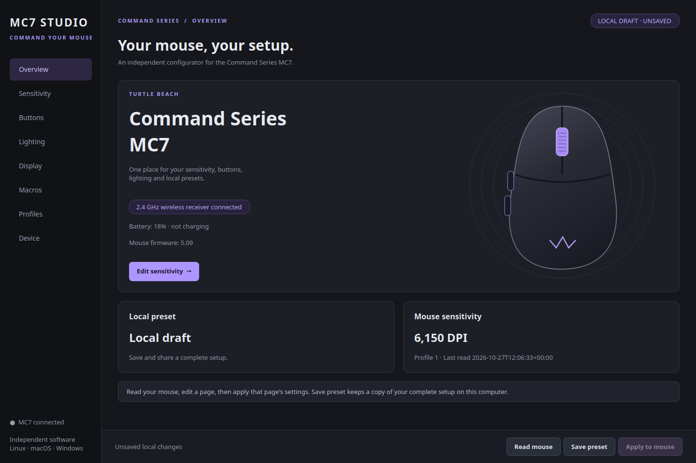
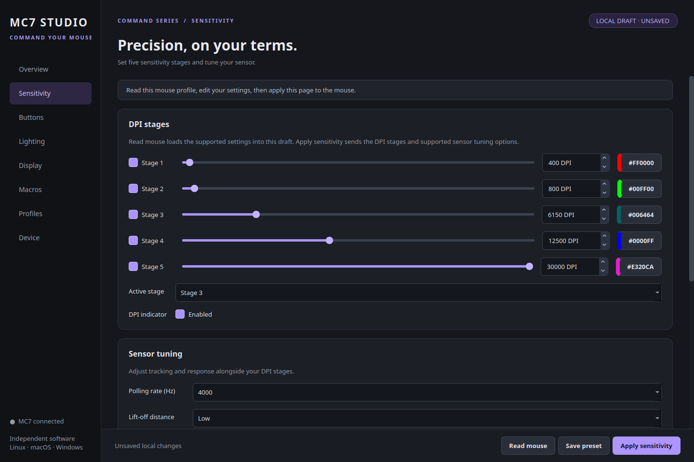

# MC7 Studio

**Configure your Turtle Beach Command Series MC7 on Linux, macOS and Windows.** MC7 Studio is an independent, native desktop application for onboard profiles, sensor settings, buttons, macros, lighting and the mouse's touch display.

[Download 0.2.1](https://github.com/dev-zetta/mc7_studio/releases/tag/v0.2.1) · [Getting started](docs/getting-started.md) · [User guide](docs/user-guide.md) · [Report a problem](https://github.com/dev-zetta/mc7_studio/issues)

<p align="center"><a href="https://www.turtlebeach.com/products/command-series-mc7-mouse"></a></p>

*Command Series MC7 product image © Turtle Beach, linked from its [official product page](https://www.turtlebeach.com/products/command-series-mc7-mouse). MC7 Studio is not affiliated with or endorsed by Turtle Beach.*



*The native MC7 Studio interface. Read settings from the mouse, edit a local draft, then apply the page you changed.*

<details><summary>See the sensitivity editor</summary>



</details>

## What’s new in 0.2.1

- **Surface calibration:** completed and saved over USB and Linux 2.4 GHz at 4 kHz, with more time for movement and verified settings readback.
- **Application icons:** replacing an icon or changing an application label refreshes the mouse display automatically and preserves other tiles that shared the original icon.
- **8 kHz wireless configuration:** improved polling-rate changes and subsequent settings reads.
- **Reliable profile reads:** LCD services check the requested profile and page before accepting a cached receiver reply.

## Features

- **Profiles and presets:** five onboard profiles, profile activation, named local presets, colors, images, import and export.
- **Sensor controls:** five DPI stages from 50 to 30,000 DPI, polling rate, Motion Sync, debounce, angle snapping and angle tuning, plus guided calibration.
- **Buttons and macros:** standard and Easy-Shift layers, Easy-Aim, Easy-Wheel, keyboard shortcuts, media controls, and keyboard/mouse macros with Once, Repeat, While held and Toggle playback.
- **Lighting and power:** RGB effects, colors, brightness and speed; LED timeout, standby, ECO mode and energy saving.
- **Touch display:** three pages of four slots, DPI and media tiles, shortcuts, countdowns, system values, custom PNG/JPEG backgrounds, application icons, brightness, timeout and haptic feedback.
- **Desktop integrations:** foreground-application profiles, application/file/website launchers, desktop media control, OBS actions, battery monitoring, tray notifications and supported start-at-login setup.
- **Firmware tools:** installed firmware status, verified official package downloads, guarded upgrade preparation and readable-settings backup restoration.

## Download

Get the application and adjacent checksum from [GitHub Releases](https://github.com/dev-zetta/mc7_studio/releases/latest).

| Platform | Package | Requirements |
| --- | --- | --- |
| Linux | `MC7-Studio-0.2.1-x86_64.AppImage` | x86_64, glibc 2.35 or newer, graphical desktop |
| Windows | `MC7-Studio-0.2.1-windows-x86_64.zip` | 64-bit Windows 10 or newer |
| macOS | `MC7-Studio-0.2.1-macos-arm64.zip` | Apple Silicon M1 or newer, macOS 13 or newer |
| Python installation | Wheel or source archive | Python 3.10 or newer; install the `[gui]` extra |

The portable packages include Python, Qt, HIDAPI, 7-Zip and the application dependencies. Windows packages are unsigned; the macOS app is ad-hoc signed and is not Apple notarized.

### Linux AppImage

```sh
sha256sum -c MC7-Studio-0.2.1-x86_64.AppImage.sha256
mkdir -p "$HOME/Applications"
mv MC7-Studio-0.2.1-x86_64.AppImage "$HOME/Applications/"
chmod +x "$HOME/Applications/MC7-Studio-0.2.1-x86_64.AppImage"
"$HOME/Applications/MC7-Studio-0.2.1-x86_64.AppImage"
```

Open **Device → Check and install host integration…** to install the USB access rule, then reconnect the mouse or receiver. Run the application as your normal desktop user.

### Windows and macOS

On Windows, verify the ZIP's SHA-256 checksum, extract the entire archive to a permanent folder and run `MC7-Studio.exe`. Keep `MC7-Studio-CLI.exe` and `_internal` beside it; device operations use the console helper.

On macOS, verify the ZIP with `shasum -a 256 -c MC7-Studio-0.2.1-macos-arm64.zip.sha256`, extract it in Finder and move **MC7 Studio.app** to **Applications**. If macOS blocks the first launch, review the download and use **System Settings → Privacy & Security → Open Anyway**.

## Connect and configure

1. Connect the mouse directly by USB, or connect its 2.4 GHz receiver on Linux and wake the mouse in wireless mode.
2. Choose **Device → Refresh devices**, then select the wired mouse or wireless receiver.
3. Select an onboard profile and choose **Read mouse**.
4. Edit a settings page and choose its **Apply** button. The application checks for conflicting changes and verifies the result by reading it back.
5. Use **Save preset** to keep a local copy of your configuration. Saving a preset and applying settings to the mouse are separate actions.

Sensitivity, button assignments, supported macros, lighting, LCD layout and power settings are stored on the mouse. Host-assisted LCD actions, countdowns, live system values and automatic profiles need MC7 Studio running; see [Desktop integrations](docs/integrations.md).

## Connection and platform support

| Connection | Linux | Windows | macOS |
| --- | --- | --- | --- |
| Direct USB mouse | Hardware tested on firmware 5.09 | Implemented; physical hardware acceptance pending | Implemented; physical hardware acceptance pending |
| 2.4 GHz receiver | Supported in 0.2 | Unavailable | Unavailable |
| Bluetooth | Unavailable | Unavailable | Unavailable |

Only the Command Series MC7 is supported. Wireless feature validation is less complete than wired validation. Custom surface calibration remains experimental: version 0.2.1 has passed completion, saving, readback and user tracking checks over USB and Linux 2.4 GHz at the 4 kHz setting on firmware 5.09. Use a direct USB connection for long-running LCD services and firmware operations. Version 0.2.1 has passed wireless application-icon upload, replacement, rendering and launch checks at 4 kHz, plus 8 kHz configuration, readback and pointer-responsiveness checks; effective report frequency and latency have not been measured. Close Swarm II and other configurators before opening a device session.

Upgrade from 0.2.0 to 0.2.1 for the wireless 8 kHz handshake, application-icon refresh and surface-calibration fixes. See the [0.2.1 release notes](docs/releases/0.2.1.md).

On 2.4 GHz, enable **ECO mode or energy saving**, one at a time. With mouse firmware 5.09 and receiver firmware 5.02, enabling both keeps pointer input working but disconnects configuration access. MC7 Studio disables Apply for that combination and rejects it before any HID report is sent. Use USB if you need both enabled.

Automatic foreground profiles support X11, GNOME Wayland with the bundled companion, Sway, Hyprland, macOS and Windows. KDE Plasma and other Wayland compositors are not supported. Start-at-login setup is available on Linux and macOS. Windows desktop media playback-state control and per-application audio volume remain unavailable.

## Firmware and recovery

The Linux updater has completed an official mouse firmware upgrade from 5.04 to 5.09. Firmware installation requires a direct USB cable. Windows supports package download and inspection; installation is disabled. Downgrade, transmitter flashing, interrupted-update recovery and macOS firmware installation remain unvalidated.

A settings backup is not a firmware image and cannot preserve custom LCD image pixels. Keep original images and exported presets. Read [Firmware and recovery](docs/firmware.md) before updating.

## Documentation and diagnostics

- [Getting started](docs/getting-started.md)
- [User guide](docs/user-guide.md)
- [Desktop integrations](docs/integrations.md)
- [Firmware and recovery](docs/firmware.md)
- [Troubleshooting](docs/troubleshooting.md)

The AppImage also accepts diagnostic commands:

```sh
~/Applications/MC7-Studio-0.2.1-x86_64.AppImage doctor
~/Applications/MC7-Studio-0.2.1-x86_64.AppImage devices
~/Applications/MC7-Studio-0.2.1-x86_64.AppImage read --profile 1 --json
```

Wheel and source installations provide the same commands through `swarm2`. If multiple accessible mice are present, use `read --device` with the physical ID shown by the application. Discovery and `doctor` do not open HID handles or change mouse settings.

## Install from source

```sh
python3 -m venv .venv
.venv/bin/python -m pip install '.[gui]'
.venv/bin/swarm2-gui
```

Wine and Ghidra are not needed to install, build or use MC7 Studio.

## Build the portable packages

Linux uses the same pinned Docker build locally and in GitHub Actions:

```sh
scripts/build_appimage_docker.sh
```

Native Windows and macOS packages are built on their respective platforms with `scripts/build_windows.py` and `scripts/build_macos.py`. The release workflow runs unit tests, package verification and graphical startup checks before assembling a draft. AppImage startup is also checked on Ubuntu, Fedora and Arch Linux.

## License

MC7 Studio's original source code is Copyright © 2026 Gabriel Max and released under the [GNU General Public License version 3 or later](LICENSE). Bundled components retain their own licenses and notices. Release assets include checksums and corresponding sources for the bundled copyleft components. Turtle Beach firmware payloads are not redistributed; the firmware provenance archive contains public download URLs and verification metadata.
